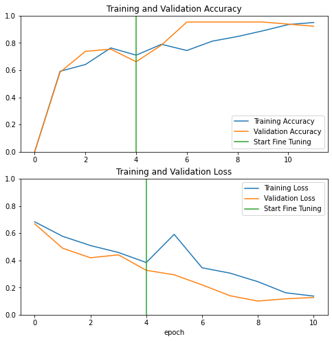

# Computer vision: segmentation and transfer learning

Two computer-vision workflows demonstrate U-Net semantic segmentation and MobileNetV2 transfer learning. Both build on supplied notebook scaffolding and datasets; the contributions and limitations are stated in each notebook.

## Road-scene segmentation with U-Net

[Open the segmentation notebook](W3_Object_Detection/z_completed/W3A2/Image_segmentation_Unet_v2.ipynb)

A U-Net encoder-decoder produces pixel-level road-scene predictions. The saved example compares an input image, reference mask and model output.

**Evidence and limitation:** The saved notebook includes training outputs and qualitative masks, but no held-out mIoU or class-wise evaluation. The visual is not evidence of generalization.

## Alpaca image classification with MobileNetV2

[Open the transfer-learning notebook](W2_Deep_CNN_models_case_studies/W2A2/Transfer_learning_with_MobileNet_v1.ipynb)

A pretrained MobileNetV2 backbone is adapted for binary image classification with augmentation and fine-tuning.

**Evidence and limitation:** The final displayed validation accuracy in the saved run is approximately 92.31%. The notebook does not report an independent held-out test benchmark or class-wise errors.

## Reproduction requirements

The original environment has not been pinned or revalidated. The notebooks use Python, TensorFlow/Keras, NumPy and Matplotlib, with image-processing libraries and supplied helper files. U-Net expects `data/CameraRGB/` and `data/CameraMask/`; MobileNet expects `dataset/` and the pretrained weight files under `imagenet_base_model/`. These datasets and weight files are not all included. Restore compatible inputs and versions before running either notebook.

## Next evaluation

For U-Net, define an independent test split and report mean and class-wise intersection over union, with examples of missed objects and difficult scenes. For MobileNetV2, compare a frozen-backbone baseline with fine-tuning on a held-out test set and report class-level precision, recall and failure cases. Neither evaluation is included in the saved notebooks.

## Attribution

Adapted from exercises in DeepLearning.AI’s Deep Learning Specialization. The original notebook scaffolding, utilities, diagrams, datasets and pretrained models belong to their respective authors. Saved metrics and visual outputs have not been regenerated for this presentation update.
