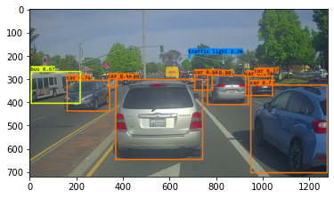
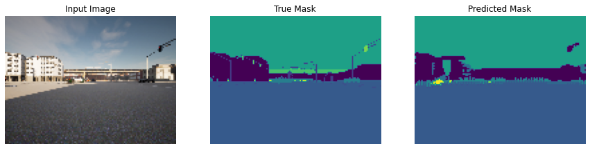
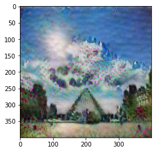

# Computer Vision: Classification, Detection, and Segmentation

I implemented computer vision workflows for image classification, road-scene object detection, semantic segmentation, face verification, and neural style transfer. The work spans NumPy convolution operations, TensorFlow/Keras architectures, and inference using pretrained feature extractors.

## My implementation

- Implemented convolution and pooling operations with backpropagation, residual blocks, and a U-Net encoder-decoder within the supplied notebooks.
- Built a MobileNetV2 transfer-learning workflow with augmentation and fine-tuning.
- Implemented YOLO confidence filtering, intersection over union, and non-max suppression, plus triplet loss and content/style objectives for embedding-based applications.

## Selected results

The ResNet notebook records **80.83% test accuracy**. The U-Net notebook includes an input image, reference mask, and predicted mask; its saved training accuracy is not a held-out segmentation benchmark. The examples below show outputs from the detection, segmentation, and style-transfer workflows.

Pretrained YOLO, MobileNetV2, face-embedding, and VGG models supply learned features where indicated. My work focuses on the implemented components and application workflows. Results and images are from saved notebook runs.

## Visual examples

### Object detection

The saved YOLO output applies confidence filtering and non-max suppression to predictions from a pretrained detector.

### Semantic segmentation

A saved U-Net example compares the input image, reference mask, and predicted segmentation.

### Neural style transfer

The generated image combines content and style losses computed from pretrained VGG features.

## Projects

| Project | Implementation |
| --- | --- |
| [Convolutions from scratch](W1_Foundations%20of%20CNN/W1A1/W1A1/Convolution_model_Step_by_Step_v1.ipynb) | NumPy implementations of convolution, padding, pooling, and backpropagation. |
| [CNN image classification](W1_Foundations%20of%20CNN/W1A1/W1A2/Convolution_model_Application.ipynb) | Building and training convolutional models in TensorFlow/Keras. |
| [Residual networks](W2_Deep_CNN_models_case_studies/W2A1/Residual_Networks.ipynb) | Identity and convolutional blocks for a ResNet architecture. |
| [Transfer learning](W2_Deep_CNN_models_case_studies/W2A2/Transfer_learning_with_MobileNet_v1.ipynb) | Data augmentation and fine-tuning a pretrained MobileNetV2 backbone. |
| [YOLO object detection](W3_Object_Detection/W3A1_copy/Autonomous_driving_application_Car_detection.ipynb) | Confidence filtering, intersection over union, and non-max suppression on pretrained detections. |
| [U-Net segmentation](W3_Object_Detection/z_completed/W3A2/Image_segmentation_Unet_v2.ipynb) | An encoder-decoder model with skip connections for pixel-level predictions. |
| [Face verification and recognition](W4_Face_Recognition%20%26%20Neural%20style%20transfer/ANSWERED/W4A1/Face_Recognition.ipynb) | Triplet loss and comparisons between pretrained face embeddings. |
| [Neural style transfer](W4_Face_Recognition%20%26%20Neural%20style%20transfer/ANSWERED/W4A2/Art_Generation_with_Neural_Style_Transfer.ipynb) | Optimizing an image using content and style representations from pretrained VGG features. |

## Run locally

The notebooks use Python, NumPy, TensorFlow/Keras, Matplotlib, Pillow, h5py, and imageio. Open Jupyter from the selected notebook directory. Restore the datasets and pretrained weights at the relative paths used by that notebook, then run its cells in order. Some notebooks require TensorFlow/Keras versions compatible with their original APIs.

Figures and metrics on this page are taken from saved notebook outputs. A fresh environment and full execution have not been verified for this documentation update.

## Acknowledgements

Developed from exercises in Andrew Ng's Deep Learning Specialization by DeepLearning.AI. The original problem statements, starter code, supplied utilities, diagrams, datasets, and pretrained models belong to their respective authors. Existing third-party attribution and licenses are retained.
