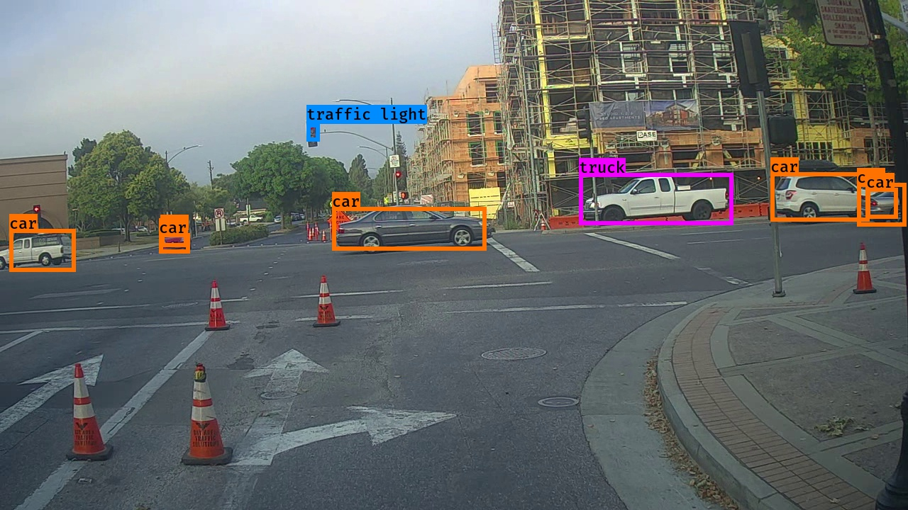

# Autonomous Driving - Car Detection (YOLO)

Object detection for autonomous driving using YOLO (You Only Look Once), built with TensorFlow/Keras. Detects and draws bounding boxes around cars, pedestrians, traffic lights, and other objects in road images.



## Overview

This implements the core filtering and post-processing logic of the YOLO object detection pipeline on top of a pretrained YOLOv2 model:

- **`yolo_filter_boxes`** — thresholds YOLO's raw per-cell, per-anchor-box predictions on class confidence score
- **`iou`** — computes Intersection over Union between two bounding boxes
- **`yolo_non_max_suppression`** — removes overlapping duplicate detections of the same object using IoU-based non-max suppression
- **`yolo_eval`** — combines the above into the full YOLO output pipeline: converts the model's raw encoding into a final, non-overlapping set of scored bounding boxes

Given a road image, the pipeline runs it through a pretrained CNN, decodes the (19, 19, 5, 85) output volume into candidate boxes, filters them by confidence, and applies non-max suppression per class to produce the final detections.

## Project structure

```
├── Autonomous_driving_application_Car_detection.ipynb   # Main notebook: YOLO pipeline implementation
├── unit_tests.py                                          # Additional sanity checks for the core functions
├── yad2k/                                                  # Darknet-to-Keras YOLO model code (Allan Zelener, MIT)
├── font/                                                   # Font used for drawing labels on detections
├── images/                                                 # Sample road images (Drive.ai dataset, CC BY 4.0)
├── model_data/                                             # Pretrained YOLOv2 weights, class names, anchor boxes
├── nb_images/                                              # Diagrams and demo videos used in the notebook
├── out/                                                    # Example detection output
└── LICENSE, Drive.ai Dataset Sample LICENSE
```

## Running it

Requires `tensorflow`, `numpy`, `pillow`, and the bundled `yad2k` module. Open the notebook and run the cells in order — the pretrained model in `model_data/` is loaded directly, no training required. Run the cells under section 3 to try detection on a sample image from `images/`, or swap in your own.

## Results

Running the pipeline on `images/test.jpg` correctly detects 10 objects (cars, a bus, and a traffic light) with confidence scores from 0.36–0.89 — see `out/annotated.jpg` above.

## Acknowledgements

Built while completing DeepLearning.AI's Deep Learning Specialization (Convolutional Neural Networks course) on Coursera. `yad2k/` (Darknet-to-Keras conversion) is Allan Zelener's [YAD2K](https://github.com/allanzelener/YAD2K), used under MIT license. The pretrained YOLOv2 weights in `model_data/` come from the [official YOLO website](https://pjreddie.com/darknet/yolo/) — not trained by me. Sample images are from the [Drive.ai Sample Dataset](https://www.drive.ai/), CC BY 4.0. The four functions listed under Overview are my implementation.

- Redmon, Divvala, Girshick, Farhadi — [You Only Look Once: Unified, Real-Time Object Detection](https://arxiv.org/abs/1506.02640) (2015)
- Redmon, Farhadi — [YOLO9000: Better, Faster, Stronger](https://arxiv.org/abs/1612.08242) (2016)
